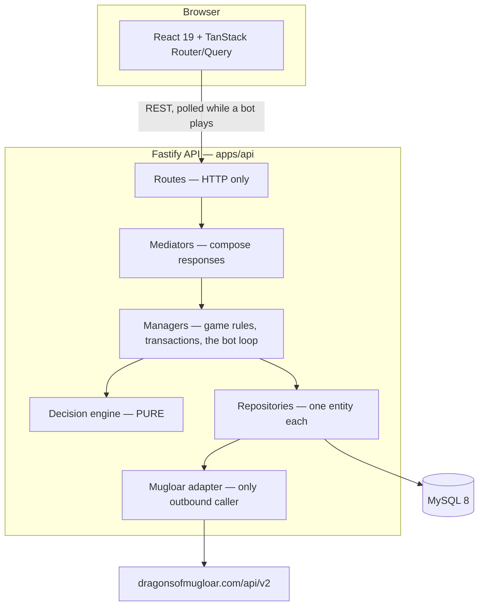

# Architecture

## Overview

One pnpm monorepo, three runtime pieces. Fastify is the **only** thing that talks
to `dragonsofmugloar.com`; the browser never does. In Docker the same Fastify
process also serves the built React app, so the app and `/api` share one origin.



Why everything goes through Fastify: one source of truth for game state; the
decode / retry / `410` logic is written once instead of twice in two languages;
and the advisor can draw on history from every past game, which a browser-only
client could never do.

---

## Layers

```
Routes → Mediators → Managers → Repositories → Adapters
```

Dependencies move **downward only**. Never skip a layer, never call upward.
`eslint.config.mjs` enforces this with `no-restricted-imports` for `routes/`,
`mediators/`, `bot/`, `managers/`, `repositories/` and `domain/`, so a shortcut fails `pnpm lint`.
No rule is relaxed for the bot: the loop that calls `decide()` is a manager precisely
so that routes and mediators never import the engine.

| Layer            | May call                             | Must not                                               |
| ---------------- | ------------------------------------ | ------------------------------------------------------ |
| **Routes**       | Mediators, Managers                  | contain business logic; touch repositories or adapters |
| **Mediators**    | Managers                             | contain game rules; touch repositories                 |
| **Managers**     | Repositories, Engine, other Managers | be called by anything below them; touch adapters ¹     |
| **Repositories** | one data-source Adapter              | span entities; call managers or other repositories     |
| **Adapters**     | one external system                  | contain business logic                                 |
| **Engine**       | nothing                              | perform I/O of any kind                                |

¹ The one exception is `withTransaction` from `mysql-adapter`: a manager owns
the transaction boundary, so it opens the transaction and hands it to repositories.

`bot/` holds what only the CLIs use (the `runBot` wrapper, the benchmark, its
pool and report) and stands at the mediator level: it calls managers only. Routes
reach managers through `mediators/game-mediator/` and `mediators/bot-mediator/`,
which turn manager results into the `packages/contracts` response shapes
(`GameView`, `TurnView`, `MoveResult`, `Move`).
Shared types that cross layers live in `entities/` (`UpstreamResult`, the solve
and buy outcomes) rather than in the adapter that first produces them.

### Routes

Thin. Extract from the request, call a mediator (or a manager when there's
nothing to compose), bind the response. No logic. Errors bubble to the single
registered Fastify error handler — routes never catch. See
[`routes.md`](routes.md).

### Mediators

API-facing aggregators. They call multiple managers and shape an API response.
They hold no game rules. One file per use case inside an entity folder, named
for the operation — `game-mediator/start-game.ts`, not one growing file.

### Managers

Own one entity's lifecycle, its rules and its transaction boundary. A manager
may compose every repository its transaction writes: `game-manager/` owns the
game state machine and writes a turn's run update together with its attempt or
purchase row, atomically. It also fronts the turn's reads (`findAds`,
`findShopItems`, `findMoves`) so that callers never reach a repository.
`calibration-manager/` turns stored attempts into a `Calibration`, falling back
to the prior when the read fails. `bot-manager/` owns the bot's play loop
(`playGame`) and `execute-decision.ts`, which turns a `Decision` into a call on
`game-manager`; see _Bot runtime_.

### Repositories

One entity each, with one file per data source:
`<entity>-repository/{db.ts, mugloar.ts}`, exposed as
`gameRunRepository.db.createOne(...)` and `gameRunRepository.mugloar.createOne()`.
Enforce no business rules. On the DB side, `transform` / `reverseTransform`
convert between the row shape (snake_case) and the domain entity (camelCase).
On the mugloar side, the zod schema's `transform` maps the wire shape into an
entity (`SolveOutcome`, `BuyOutcome`), so `shoppingSuccess` and `highScore`
never get past the repository.

"One entity" governs what a repository returns and writes. A read may still
filter by a related table: `findCalibrationCounts` scopes attempts to a
benchmark with a subquery on `game_runs`. That is cheaper than a second
round-trip through `gameRunRepository`, and it writes nothing.

The `mugloar` side owns the endpoints: the path, the wire schema, and decoding
encrypted ads.

| Upstream call                  | Repository                              |
| ------------------------------ | --------------------------------------- |
| `POST /game/start`             | `gameRunRepository.mugloar.createOne`   |
| `GET /{gameId}/messages`       | `adRepository.mugloar.findMany`         |
| `POST /{gameId}/solve/{adId}`  | `adAttemptRepository.mugloar.createOne` |
| `GET /{gameId}/shop`           | `shopItemRepository.mugloar.findMany`   |
| `POST /{gameId}/shop/buy/{id}` | `purchaseRepository.mugloar.createOne`  |

Every repository is a plain object, never a bare module export: ESM namespaces
are frozen, and `vi.spyOn` needs something it can patch.

### Adapters

Wrap exactly one external system. `mugloar-api-adapter` is the only code in the
repo that knows the upstream exists, and the only place that knows it is
unreliable — timeouts, bounded retry, HTML-body tolerance and the `410`
translation all live there and nowhere else.

It exposes one generic call, `mugloarApiAdapter.request({ operation, method,
path, schema })`, which repositories use. GET is retried and POST never is,
which puts the rule in one place rather than in every caller. It reads config
from the environment on each call, uses the global `fetch`, and takes a token
from the process-wide `mugloarThrottle` before every attempt.

### Engine

**Pure.** No I/O, no clock, no randomness, no imports from outside `domain/`.
The engine owns its input types: `CalibrationCount` is defined in
`calibration.ts`, and the repository maps rows into it.

---

## Verified API reference

**This section is ground truth and overrides https://dragonsofmugloar.com/doc/.**
Verified against the live API on 2026-11-23.

Base URL: `https://dragonsofmugloar.com/api/v2`. No auth, no API key.

### Endpoints

| Method | Path                               | Returns                                                     |
| ------ | ---------------------------------- | ----------------------------------------------------------- |
| POST   | `/game/start`                      | `{ gameId, lives, gold, level, score, highScore, turn }`    |
| GET    | `/{gameId}/messages`               | **bare array** of ads                                       |
| POST   | `/{gameId}/solve/{adId}`           | `{ success, lives, gold, score, highScore, turn, message }` |
| GET    | `/{gameId}/shop`                   | **bare array** of `{ id, name, cost }`                      |
| POST   | `/{gameId}/shop/buy/{itemId}`      | `{ shoppingSuccess, gold, lives, level, turn }`             |
| POST   | `/{gameId}/investigate/reputation` | `{ people, state, underworld }`                             |

A new game starts at `lives: 3, gold: 0, level: 0, score: 0, turn: 0`.

### Where the published docs lie

| Docs say                                  | Reality                         |
| ----------------------------------------- | ------------------------------- |
| `/messages` returns `{ messages: [...] }` | returns a **bare array**        |
| `/shop` returns `{ items: [...] }`        | returns a **bare array**        |
| `reward` is a String                      | it is a **Number**              |
| `shoppingSuccess` is a String             | it is a **Boolean**             |
| _(not mentioned)_                         | ads carry **`probability`**     |
| _(not mentioned)_                         | ads carry **`encrypted`**       |
| _(not mentioned)_                         | errors are **HTML**, never JSON |
| _(not mentioned)_                         | game over is **HTTP 410**       |

An ad:

```json
{
  "adId": "BR0b2WyN",
  "message": "Help Gisilfrid Jephson to transport a magic wagon to village in Blackcawl",
  "reward": 17,
  "expiresIn": 7,
  "encrypted": null,
  "probability": "Piece of cake"
}
```

### Encryption

`encrypted` is `null`, `1` or `2`, and applies to **`adId`, `message` and
`probability`** — never to `reward` or `expiresIn`.

- `encrypted: 1` → **Base64**. Verified.
- `encrypted: 2` → **ROT13**. Verified 2026-11-23 from recorded live responses: probability
  `Vzcbffvoyr` → `Impossible`. Rare — one board in four recording sessions. That ad
  was `Impossible`, so solving with a decoded ROT13 `adId` is still unobserved.

**The `adId` must be decoded before use in the solve URL.** Verified:

```
adId "cVlmaFlnRnQ=" → "qYfhYgFt"
POST /solve/cVlmaFlnRnQ=  → 400 Bad Request
```

Encrypted ads carry disproportionately large rewards (122 and 193 observed
against a typical 1–64), so skipping them is expensive.

### Probability labels

Eleven observed. `"Impossible"` is undocumented and went 0/16 — it is a hard
filter, never an EV calculation.

Prior ranking, best → worst. **A prior only** — the engine measures rather than
trusts it:

```
Sure thing · Piece of cake · Walk in the park · Quite likely · Hmmm....
Gamble · Risky · Rather detrimental · Playing with fire · Suicide mission
Impossible
```

### Shop

Effects verified by buying each item in a fresh game.

| id                                    | name           | cost | effect        |
| ------------------------------------- | -------------- | ---- | ------------- |
| `hpot`                                | Healing potion | 50   | **+1 life**   |
| `cs` `gas` `wax` `tricks` `wingpot`   | —              | 100  | +1 level      |
| `ch` `rf` `iron` `mtrix` `wingpotmax` | —              | 300  | **+2 levels** |

Items of equal cost are interchangeable. The listing is not guaranteed static —
read `/shop` rather than hard-coding ids; keep this table as the fallback prior.

### Errors and lifecycle

| Situation                    | Response                             |
| ---------------------------- | ------------------------------------ |
| Unknown `gameId`             | `404`, **HTML** body                 |
| Unknown or expired `adId`    | `400`, **HTML** body                 |
| Insufficient gold            | `200` + `{"shoppingSuccess": false}` |
| Unknown item id              | `200` + `{"shoppingSuccess": false}` |
| Any call after lives reach 0 | `410` + `{"status": "Game Over"}`    |

Three consequences that cause real bugs if missed:

1. **A failed purchase still advances the turn**, so it costs `expiresIn` on
   every ad on the board. Never speculatively buy.
2. **`410` is a terminal domain state, not an error.** The adapter translates it;
   it never throws.
3. **Never assume a parseable JSON body on a non-2xx response.** This is the
   most likely source of an unhandled crash.

---

## Decision engine

```ts
// pure — no I/O, no clock, no randomness
decide({ state, board, shop, calibration, config }): Decision
```

`Decision` is a discriminated union — `solve`, `buy`, or `stop` — each carrying
a **structured `reasoning` value, not a string**: the estimated success
probability, the expected value, and which rule fired. The bot logs it; the UI
renders it. That is what makes "watch the bot" explicable instead of a spinner.

### Advisor

`adviseBoard` wraps `decide` for the human player. It returns the same
`Decision` as the recommendation, plus a verdict for every ad on the board:
`recommended`, `viable`, `long_shot` or `unattemptable`. The advisor calls
`decide` rather than re-implementing it, so the bot and the advice cannot
disagree. When the player picks a different ad, `playerChoiceReasoning` records
the engine's estimate for that ad, with rule `player_choice`.

### Calibration

Every attempt is written to `ad_attempts` with its label, dragon level, turn,
reward and outcome. The estimate is a success rate shrunk toward a per-label
prior, keyed on `(label, levelBucket, rewardBand)`:

```
p̂ = (successes + α·prior) / (attempts + α)      α = smoothingAlpha (tuned: 2)
```

With little data the prior dominates; as evidence accumulates, measurement takes
over. Deliberately simple and explainable — a human must be able to justify it on
a whiteboard.

Level **buckets**, not raw levels: the observed degradation is gradual and raw
cells would be too sparse.

**Reward bands** (edges in `StrategyConfig.rewardBandEdges`) because the label
alone lies on lucrative ads. Measured over 20 cold runs: `Sure thing` under 100
gold went 47/47; at 160 and above it went 1/45. Pooling them taught the engine
that a trap was safe. The repository returns raw rewards; the engine buckets
them, so the edges are tunable without a query change.

Calibration is **reloaded before every decision**, not once per game: a run's own
failures, and those of concurrent benchmark games, count from the next turn.

### Selection

1. **Hard filter** — drop `Impossible`; drop ads that have already expired
   (`expiresIn` of 0 or less).
2. **Estimate** `p̂` from calibration.
3. **Expected value** — `EV = p̂ · reward − (1 − p̂) · lifeCost`, where
   `lifeCost` is a healing potion (50 gold) plus the turn it burns. This converts
   risk into gold so risky-lucrative and safe-cheap ads compare on one axis.
4. **Survival override**: lives, not gold, are the binding constraint. At or
   below `livesFloor` the engine buys `hpot` before anything else. The tuned
   floor equals the starting lives (3), so every lost life is bought back as soon
   as gold allows. Lives can rise above the start (observed up to 12), but the
   engine never buys above the floor.
   Measured: a run surviving ~90 turns scored 6840; one dying at turn 24 scored 467. **Survival is the strategy.**
5. Take the highest EV clearing `minimumProbability`; else the safest
   attemptable ad; else stop. Stopping means the board is exhausted (every ad
   `Impossible` or expired, measured from turn ~95). Nothing for sale revives
   it, so the engine does not spend gold there. With `levelUpEnabled` (off by
   default) the engine also levels up when no ad clears the floor or when gold
   above `levelUpGoldReserve` allows.

All thresholds live in one typed `StrategyConfig`. No magic numbers in the
engine.

### Two strategies

| Strategy     | Uses history     | Purpose                                                           |
| ------------ | ---------------- | ----------------------------------------------------------------- |
| `baseline`   | no — priors only | EV + survival floor. Tests whether the database is needed at all. |
| `calibrated` | yes              | The designed engine.                                              |

Both satisfy the same signature and differ only in the `Calibration` passed in.
The comparison was run in Phase 1 and the result is recorded below, whichever way
it fell.

---

## Bot runtime

One loop, three callers. `managers/bot-manager/play-game.ts` plays a game from
its start state to the end: load the shop once, then each turn fetch the board,
reload calibration, call `decide`, and execute the `Decision` through
`game-manager`. The loop lives in a manager because it calls the engine, and
`eslint.config.mjs` forbids routes and mediators from importing `domain/`.

| Caller                         | How it uses the loop                                                      |
| ------------------------------ | ------------------------------------------------------------------------- |
| `pnpm bot` (`bot/run-bot.ts`)  | Starts a game, awaits `playGame`, prints the result.                      |
| `pnpm bench` (`bot/benchmark`) | Runs `runBot` concurrently and reports the pass rate against 1000.        |
| `POST /api/bot-games`          | `bot-mediator/start-bot-game.ts` starts a game and **detaches** the loop. |

The `advisor-manager` and the bot go through the same `game-manager` and
`calibration-manager`, so the human's advice and the bot's moves share one code
path.

### Detached bot games

`POST /api/bot-games` answers `201` with the new `GameView` as soon as the
upstream game exists. The mediator starts `playGame` with `void` and a `.catch`
that logs; nothing awaits it. The game then plays inside the API process, after the
request has returned, with strategy `calibrated` and calibration over **all**
history (`calibrationBenchmarkId: null`, as `pnpm bot` does).

- **No unhandled rejection.** `playGame` finalises the run as `abandoned` before it
  rethrows, so the row never stays `active` after an error; the mediator's catch
  only reports the failure through `app.log`.
- **How a game ends.** Lives reaching zero is `game_over`. The engine returning
  `stop` is `abandoned`, because the upstream game is still alive. The usual real
  ending is `abandoned` (the board has run dry, from turn ~95) with a score well
  over 1000; both are finished.
- **Viewing.** There is no registry, no SSE and no push. The loop writes the same
  rows a human's moves do, and a viewer reads them: `GET /api/games/:gameId` and
  `GET /api/games/:gameId/moves` are database reads, polled by the web app. Any
  number of viewers can come and go without affecting the run. A bot game is
  refused by the player routes with `409`.
- **Concurrency.** Bot games, benchmark games and human moves share one
  process-wide token bucket on the outbound side (`MUGLOAR_RATE_PER_SECOND`, 8 by
  default), because what is protected is the remote host. There is no cap on the
  number of concurrent bot games; they simply slow each other down.
- **Restart.** The loop lives in the process. An API restart (or `docker compose
down`) stops it mid-game and leaves the run `active`; it is not resumed. A
  human's game is unaffected, because its state is persisted per move.

A separate worker would need a queue, a second deployable and a cross-process
event path to reach a viewer: real cost, no reviewer-visible benefit at this
size. `playGame` takes everything it needs as arguments, so moving it out later is
contained.

---

## Measured findings

Recorded as they are established. A documented negative result is a finding.

| Question                                 | Status  | Result                                                                                                                          |
| ---------------------------------------- | ------- | ------------------------------------------------------------------------------------------------------------------------------- |
| Does `calibrated` beat `baseline`?       | yes     | 90% vs 55% pass over 20 cold runs each, before any tuning                                                                       |
| Do labels mean the same at every reward? | **no**  | `Sure thing` 47/47 under 100 gold, 1/45 at 160+ — hence reward bands in the calibration key                                     |
| Does levelling up pay?                   | partly  | proactive (20 runs each): off 100% pass / median 2510, on 95% / 3348, one game apart, so **off**. On an exhausted board: **no** |
| Does the board run dry?                  | **yes** | by turn ~95 every ad is `Impossible`, and 8–22 level-ups bought there won nothing more; the game is over in all but name        |
| Can lives exceed the starting 3?         | yes     | observed up to 12 from repeated potions                                                                                         |
| Is `encrypted: 2` ROT13?                 | yes     | captured 2026-11-23; solving needs the decoded id (raw → `400`, decoded → `200`)                                                |
| Do encrypted ads behave differently?     | no      | 0.73 vs 0.72 success; `was_encrypted` column dropped                                                                            |
| Does reputation affect anything?         | skip    | **each call burns a turn**; values move but nothing uses them                                                                   |
| Is there upstream rate limiting?         | no      | no `429` across every benchmark at 8 req/s, 3 concurrent games                                                                  |

Measured 2026-11-24 with `pnpm bench` (20 cold runs, `calibrated` strategy, tuned
defaults): **95% (19/20)** at 1000 or more. Score min 955, median 2723.5, max
3993; mean 107.6 turns. This is one measurement, not a guarantee. Cold means
"this benchmark's own games only", so the 20 games share evidence as they go.

Two things from the earlier runs on 2026-11-23, both in
[`findings/phase-1-benchmark.md`](findings/phase-1-benchmark.md):

- In the acceptance run, 16 of the 20 games stopped on an exhausted board (§7).
- A separate experiment, an exhausted-board level-up rule, was benchmarked and
  reverted. The rule never acted in its one miss: that game lost its 3 lives in 5
  turns on ads estimated at 0.73 to 0.88, with too little gold for a potion, and
  scored 21. Nothing in the engine guards the opening turns.

Tuned `StrategyConfig` (sweep in the findings file):

```ts
smoothingAlpha: 2,          // a fresh trap cell is unlearned in 3 failures, not 6
levelBucketEdges: [2, 4, 6],
rewardBandEdges: [100, 160],
livesFloor: 3,              // = starting lives: buy back every lost life
minimumProbability: 0.45,   // 0.3 cost 10 points of pass rate
lifeCostInGold: 50,
turnCostInGold: 20,
levelUpEnabled: false,      // off 100% vs on 95% in one 20-run pair: weak evidence
levelUpGoldReserve: 350,
```
