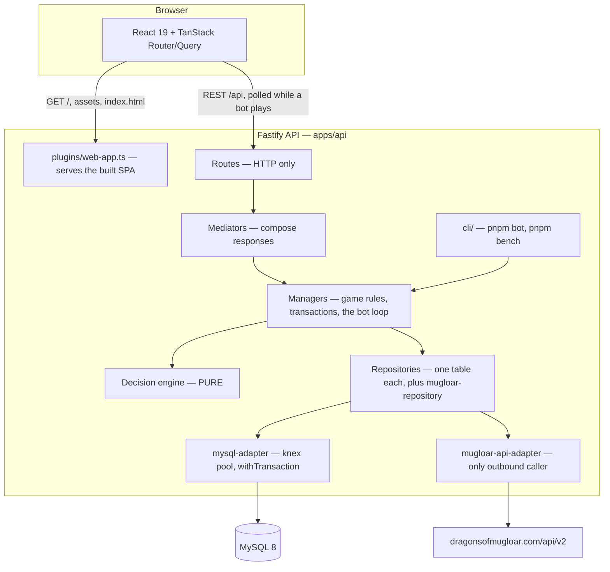

# Architecture

## Overview

One pnpm monorepo, three runtime pieces. Fastify is the **only** thing that talks
to `dragonsofmugloar.com`; the browser never does. In Docker the same Fastify
process also serves the built React app, so the app and `/api` share one origin.



`app.ts` and `cli/live-runtime.ts` are the composition roots: each loads the
config, opens the pool and calls `configureMugloarApi` once. Managers'
`withTransaction` edge to `mysql-adapter` is omitted (footnote under _Layers_).

Why everything goes through Fastify: one source of truth for game state; the
decode / retry / `410` logic is written once instead of twice in two languages;
and the advisor can draw on history from every past game, which a browser-only
client could never do.

---

## Layers

```
Routes → Mediators → Managers → Repositories → Adapters
```

Dependencies move **downward only**. Never skip a layer, never call upward.
`eslint.boundaries.mjs` (spread into `eslint.config.mjs`) enforces this with
`no-restricted-imports` for `cli/`, `routes/`, `plugins/`, `mediators/`,
`managers/`, `repositories/` and `engine/`, so a shortcut fails `pnpm lint`. The
`engine/` rules also ban the `Date`, `process`, `fetch`, `setTimeout` and
`setInterval` globals. No rule is relaxed for the bot: the loop that calls
`decide()` is a manager precisely so that routes and mediators never import the
engine. A mediator never imports a sibling mediator; what two share belongs to
a manager.

| Layer            | May call                               | Must not                                               |
| ---------------- | -------------------------------------- | ------------------------------------------------------ |
| **Routes**       | Mediators                              | contain business logic; touch repositories or adapters |
| **CLI**          | Managers ²                             | touch repositories or adapters ³                       |
| **Mediators**    | Managers                               | contain game rules; touch repositories or the engine   |
| **Managers**     | Repositories, Engine, other Managers   | be called by anything below them; touch adapters ¹     |
| **Repositories** | one data-source Adapter                | span tables; call managers or other repositories       |
| **Adapters**     | one external system                    | contain business logic                                 |
| **Engine**       | `@dragons-game/contracts` schemas only | perform I/O of any kind                                |

¹ The one exception is `withTransaction` from `mysql-adapter`: a manager owns
the transaction boundary, so it opens the transaction and hands it to repositories.
² The CLIs need `StrategyConfig` and `STRATEGY_CONFIG` to override thresholds;
`bot-manager.ts` re-exports both, so `cli/` imports nothing from `engine/`.
³ Except `cli/live-runtime.ts`, the CLIs' composition root, which opens the pool
and configures the Mugloar adapter.

`plugins/` is infrastructure wired in `app.ts`: it may use adapters and mediators
(`plugins/bot-games.ts` builds the registry from `bot-mediator`) but never managers,
repositories, the engine or routes.
`cli/` is an entry point beside `routes/`: one file per `pnpm` command
(`bot.ts`, `bench.ts`), plus `run-benchmark.ts`, `benchmark-report.ts` and the
composition root `live-runtime.ts`. It calls `bot-manager` directly: the bot
loop is a manager, and a mediator would only pass it through.

Contract shapes: `game-manager`'s `toGameView` builds `GameView`, which both
mediators return; `game-mediator.ts` builds `MoveResult` and `TurnView`;
`game-manager`'s `findMoveHistory` builds `Move[]`, which the mediator passes
through; the engine returns `Decision` and `AdvisedAd`.

`entities/` holds one type per table: `GameRun` (`game_runs`), `AdAttempt`
(`ad_attempts`) and `Purchase` (`purchases`). `game-run.ts` also owns the values
of its `strategy` column (`StrategyName`, `StrategyNameSchema`), which the web
never sees. The two types every layer needs, `Logger` and `OrGameOver`, live in
`src/types.ts`. Any other type lives beside the code that produces it:
`TurnResult` in `game-manager/turn-persistence.ts`, `RawAd` in the Mugloar adapter's
`wire-schemas.ts`, `SolveOutcome` and `BuyOutcome` in `mugloar-repository.ts`,
`BotStrategy` in `bot-manager.ts`.
The table names (`DbTables`) live in `repositories/db-tables.ts`.
`tools/` holds helpers that belong to no layer, such as `discard-outcome.ts`;
any layer may import them except the engine, which imports nothing from outside
`engine/`.

`packages/contracts` holds only what the API and the web exchange: the response
and error schemas the web parses, the id schema both sides check, and the pieces
those are built from. A schema only the API uses lives beside the layer that
uses it: path params in `routes/schemas/`, `RawAdSchema` in the Mugloar
adapter's `wire-schemas.ts`, `StrategyName` in `entities/game-run.ts` and
`IMPOSSIBLE_LABEL` in `engine/calibration.ts`.

### Routes

Thin. Extract from the request, call a mediator, bind the response. No logic.
Errors bubble to the single registered Fastify error handler; routes never
catch. See [`routes.md`](routes.md).

### Mediators

API-facing aggregators. They call multiple managers and shape an API response.
They hold no game rules. One file per mediator: `game-mediator.ts` serves the
player's routes, and `bot-mediator.ts` starts bot games and owns their registry.

### Managers

Own one entity's lifecycle, its rules and its transaction boundary. A manager is
one file until its workflow outgrows the 200-line limit; then it becomes a
folder with one file per concern and an `index.ts`, its public API, which is
all that callers import. `bot-manager.ts` is the one manager file still over
the limit. A manager may compose every repository its transaction writes:
`game-manager/` owns the game state machine and writes a turn's run update
together with its attempt or purchase row, atomically. Each of its files
imports only the files above it here:

| File                  | Concern                                                                   |
| --------------------- | ------------------------------------------------------------------------- |
| `game-state.ts`       | a run row to `GameState` and back, `toGameView`, `isOutOfLives`           |
| `game-runs.ts`        | find, start and finish a run, `recordGameOver`                            |
| `board-and-shop.ts`   | `findAds` and `findShopItems`, read from the upstream                     |
| `move-history.ts`     | `findMoveHistory`, read from the database only                            |
| `game-lock.ts`        | `withGameLock`, one move per game at a time                               |
| `turn-persistence.ts` | `saveStateWithRecord`, a turn's state and record in one transaction       |
| `play-turn.ts`        | `playSolveTurn` and `playBuyTurn`, one move for the bot and player alike  |
| `player-moves.ts`     | `solvePlayerAd` and `buyPlayerItem`, a player's move from lock to outcome |

It fronts the reads (`findAds`, `findShopItems`, `findRun`, `findPlayableRun`,
`findMoveHistory`) so that callers never reach a repository. Every move runs
through `playMove`: call the upstream, turn its answer into the next state, and
save that state with the move's record in `saveStateWithRecord`. A player's move
is wrapped in `withPlayerTurn`, which takes the per-game lock (`withGameLock`),
re-reads the playable run and the board or shop, and settles a game that ended. When the
turn's transaction fails after the upstream move happened, the caller's
`onPersistFailure` decides: `'keep_playing'` (the bot, which carries its state
in memory) logs and plays on, `'save_state_only'` (the player, whose next move
rebuilds state from the row) saves the state without the record; see
[`database.md`](database.md).
`calibration-manager.ts` turns stored attempts into a `Calibration`, falling back
to the prior (or, on a bot's re-read, the calibration it already holds) when the
read fails, and `learnFromAttempt` folds one new attempt
into a calibration in memory. `advisor-manager.ts` builds the player's advice
for a turn. `bot-manager.ts` owns the bot's play loop (`playGame`, `playTurn`)
and `executeDecision`, which turns a `Decision` into a call on `game-manager`;
see _Bot runtime_.

Managers call each other through namespace imports
(`import * as gameManager from './game-manager/index.ts'`), so a call site names
the manager it reaches.

### Repositories

One flat file per table, plus one for the upstream API:
`game-run-repository.ts`, `ad-attempt-repository.ts`,
`purchase-repository.ts` and `mugloar-repository.ts`. Callers import them as
namespaces (`import * as gameRunRepository from ...`) and call
`gameRunRepository.createOne(...)`. Repositories enforce no business rules. In
the table repositories, `transform` / `reverseTransform` convert between the
row shape (snake_case) and the entity (camelCase). In `mugloar-repository.ts`,
the zod schema's `transform` maps the wire shape into `SolveOutcome` and
`BuyOutcome`, so `shoppingSuccess` and `highScore` never get past the
repository.

"One table" governs what a table repository returns and writes. A read may still
filter by a related table: `findCalibrationCounts` scopes attempts to a
benchmark with a subquery on `game_runs`. That is cheaper than a second
round-trip through `gameRunRepository`, and it writes nothing.

`mugloar-repository.ts` owns every endpoint: the path, the wire schema, and
decoding encrypted ads. Its reads keep the `find` verb; its writes are named
for the game move (`startGame`, `solveAd`, `buyItem`) rather than `createOne`,
because each one plays a turn upstream rather than inserting a row.

| Upstream call                  | Repository                        |
| ------------------------------ | --------------------------------- |
| `POST /game/start`             | `mugloarRepository.startGame`     |
| `GET /{gameId}/messages`       | `mugloarRepository.findAds`       |
| `POST /{gameId}/solve/{adId}`  | `mugloarRepository.solveAd`       |
| `GET /{gameId}/shop`           | `mugloarRepository.findShopItems` |
| `POST /{gameId}/shop/buy/{id}` | `mugloarRepository.buyItem`       |

Tests replace a repository function with `vi.spyOn(gameRunRepository,
'updateOne')`: Vitest can patch the exports of an ESM namespace, so a repository
needs no wrapping object.

### Adapters

Wrap exactly one external system. `mugloar-api-adapter` is the only code that
knows the upstream exists and is unreliable. Repositories call its one function,
`mugloarApiAdapter.request({ operation, method, path, schema, badRequestError })`.
GET is retried with exponential backoff on a network failure or `5xx`; POST
never is.

- **Config is injected once.** Each composition root calls
  `configureMugloarApi({ config })` (`adapter-config.ts`), which also builds the
  process-wide throttle: a `p-queue` letting `MUGLOAR_BURST` requests start in
  any sliding window sized to average `MUGLOAR_RATE_PER_SECOND`. An adapter that was never configured throws
  rather than fall back to `process.env`, so a caller cannot talk to whatever
  host the environment happens to name. Tests call it through `pointAdapterAt`.
- **One deadline per attempt.** A single `AbortSignal.timeout` covers both the
  wait in the throttle queue and the `fetch`, so a backed-up queue cannot stretch
  a call past `MUGLOAR_TIMEOUT_MS`.
- **Status mapping.** `410` → `{ status: 'game_over' }`; `404` →
  `GameNotFoundError`; `400` → the caller's `badRequestError` (solve passes
  `AdExpiredError`), otherwise `UpstreamUnavailableError`; anything else non-2xx,
  a network failure or a body that fails the wire schema →
  `UpstreamUnavailableError`. The error's `cause` carries the status and the
  first 120 characters of the body for the log, never for the client.
- **Bounded bodies.** `response-body.ts` reads at most 256 KiB of a response,
  refusing a larger declared `Content-Length` up front and stopping a stream that
  passes the cap, so a misbehaving upstream cannot fill the process's memory.
- **Bad ads are dropped, not fatal.** `wire-schemas.ts` parses ad by ad and
  drops one failing `RawAdSchema`; `decodeAds` in `mugloar-repository.ts` drops
  one whose decoded label is unknown or whose decoded id is unsafe in the solve
  URL. The rest of the board stays playable. The repository returns the count it
  dropped beside the ads, and `game-manager` `findAds` logs a `warn` with it, so
  an upstream change shows in the log instead of as a quietly smaller board.

### Engine

**Pure.** No I/O, no clock, no randomness. Its only import from outside
`engine/` is `@dragons-game/contracts`, for the shared types and constants
(`Ad`, `GameState`, `Decision`, `HEALING_POTION_ID`); lint forbids `node:*`,
config, entities, tools, adapters, repositories, managers, mediators, plugins,
routes and `cli/`. The engine owns its input types: `CalibrationCount` is
defined in `calibration.ts`, and the repository maps rows into it.
`IMPOSSIBLE_LABEL`, the one label the engine never attempts, lives there too. `StrategyConfig` and the per-label
prior (`STRATEGY_CONFIG.probabilityPrior`) live in `strategy-config.ts`.

---

## Verified API reference

**This section is ground truth and overrides https://dragonsofmugloar.com/doc/.**
Verified against the live API on 2026-11-23.

Base URL: `https://dragonsofmugloar.com/api/v2`. No auth, no API key.

### Endpoints

| Method | Path                               | Returns                                                     |
| ------ | ---------------------------------- | ----------------------------------------------------------- |
| POST   | `/game/start`                      | `{ gameId, lives, gold, level, score, highScore, turn }`    |
| GET    | `/{gameId}/messages`               | **bare array** of ads                                       |
| POST   | `/{gameId}/solve/{adId}`           | `{ success, lives, gold, score, highScore, turn, message }` |
| GET    | `/{gameId}/shop`                   | **bare array** of `{ id, name, cost }`                      |
| POST   | `/{gameId}/shop/buy/{itemId}`      | `{ shoppingSuccess, gold, lives, level, turn }`             |
| POST   | `/{gameId}/investigate/reputation` | `{ people, state, underworld }`                             |

A new game starts at `lives: 3, gold: 0, level: 0, score: 0, turn: 0`.

### Where the published docs lie

| Docs say                                  | Reality                         |
| ----------------------------------------- | ------------------------------- |
| `/messages` returns `{ messages: [...] }` | returns a **bare array**        |
| `/shop` returns `{ items: [...] }`        | returns a **bare array**        |
| `reward` is a String                      | it is a **Number**              |
| `shoppingSuccess` is a String             | it is a **Boolean**             |
| _(not mentioned)_                         | ads carry **`probability`**     |
| _(not mentioned)_                         | ads carry **`encrypted`**       |
| _(not mentioned)_                         | errors are **HTML**, never JSON |
| _(not mentioned)_                         | game over is **HTTP 410**       |

An ad:

```json
{
  "adId": "BR0b2WyN",
  "message": "Help Gisilfrid Jephson to transport a magic wagon to village in Blackcawl",
  "reward": 17,
  "expiresIn": 7,
  "encrypted": null,
  "probability": "Piece of cake"
}
```

### Encryption

`encrypted` is `null`, `1` or `2`, and applies to **`adId`, `message` and
`probability`** — never to `reward` or `expiresIn`.

- `encrypted: 1` → **Base64**. Verified.
- `encrypted: 2` → **ROT13**. Verified 2026-11-23 from recorded live responses: probability
  `Vzcbffvoyr` → `Impossible`. Rare — one board in four recording sessions. A later
  probe game confirmed the solve URL needs the decoded ROT13 `adId` too (raw → `400`,
  decoded → `200`); see [`phase-1-benchmark.md`](findings/phase-1-benchmark.md).

**The `adId` must be decoded before use in the solve URL.** Verified:

```
adId "cVlmaFlnRnQ=" → "qYfhYgFt"
POST /solve/cVlmaFlnRnQ=  → 400 Bad Request
```

Encrypted ads carry disproportionately large rewards (122 and 193 observed
against a typical 1–64), so skipping them is expensive.

### Probability labels

Eleven observed. `"Impossible"` is undocumented and went 0/16 — it is a hard
filter, never an EV calculation.

Prior ranking, best → worst. **A prior only** — the engine measures rather than
trusts it:

```
Sure thing · Piece of cake · Walk in the park · Quite likely · Hmmm....
Gamble · Risky · Rather detrimental · Playing with fire · Suicide mission
Impossible
```

### Shop

Effects verified by buying each item in a fresh game.

| id                                    | name           | cost | effect        |
| ------------------------------------- | -------------- | ---- | ------------- |
| `hpot`                                | Healing potion | 50   | **+1 life**   |
| `cs` `gas` `wax` `tricks` `wingpot`   | —              | 100  | +1 level      |
| `ch` `rf` `iron` `mtrix` `wingpotmax` | —              | 300  | **+2 levels** |

Items of equal cost are interchangeable. The listing is not guaranteed static —
read `/shop` rather than hard-coding ids; keep this table as the fallback prior.

### Errors and lifecycle

| Situation                    | Response                             |
| ---------------------------- | ------------------------------------ |
| Unknown `gameId`             | `404`, **HTML** body                 |
| Unknown or expired `adId`    | `400`, **HTML** body                 |
| Insufficient gold            | `200` + `{"shoppingSuccess": false}` |
| Unknown item id              | `200` + `{"shoppingSuccess": false}` |
| Any call after lives reach 0 | `410` + `{"status": "Game Over"}`    |

Three consequences that cause real bugs if missed:

1. **A failed purchase still advances the turn**, so it costs `expiresIn` on
   every ad on the board. Never speculatively buy.
2. **`410` is a terminal domain state, not an error.** The adapter translates it;
   it never throws.
3. **Never assume a parseable JSON body on a non-2xx response.** This is the
   most likely source of an unhandled crash.

---

## Decision engine

```ts
// pure — no I/O, no clock, no randomness
decide({ state, board, shop, calibration, config }): Decision
```

`Decision` is a discriminated union — `solve`, `buy`, or `stop` — each carrying
a **structured `reasoning` value, not a string**: the estimated success
probability, the expected value, and which rule fired. The bot logs it; the UI
renders it. That is what makes "watch the bot" explicable instead of a spinner.

### Advisor

`adviseBoard` wraps `decide` for the human player. It returns the same
`Decision` as the recommendation, plus a verdict for every ad on the board:
`recommended`, `viable`, `long_shot` or `unattemptable`. The advisor calls
`decide` rather than re-implementing it, so the bot and the advice cannot
disagree. When the player picks a different ad, `playerChoiceReasoning` records
the engine's estimate for that ad, with rule `player_choice`.

### Calibration

Every attempt is written to `ad_attempts` with its label, dragon level, turn,
reward and outcome. The estimate is a success rate shrunk toward a per-label
prior, keyed on `(label, levelBucket, rewardBand)`:

```
p̂ = (successes + α·prior) / (attempts + α)      α = smoothingAlpha (tuned: 2)
```

With little data the prior dominates; as evidence accumulates, measurement takes
over. Deliberately simple enough to justify on a whiteboard. Level **buckets**,
not raw levels, because raw cells would be too sparse. **Reward bands**
(`rewardBandEdges`) because the label lies on lucrative ads (`Sure thing`: 47/47
under 100 gold, 1/45 at 160+). The repository returns raw rewards and the engine
buckets them, so the edges are tunable without a query change.

The player's advice reads calibration fresh on every `/turn`. The bot reads it
once at the start, then `learnFromAttempt` folds each of its own saved solves in
memory (an attempt whose row was lost stays out, so the in-memory calibration
always equals a fresh read), and every `CALIBRATION_REFRESH_TURNS` (10) turns it
re-reads the table to pick up concurrent benchmark games; a failed re-read keeps
what the game has learned instead of resetting to the prior. A run's own failures
count from the next turn without a query per turn.

### Selection

1. **Hard filter** — drop `Impossible`; drop ads that have already expired
   (`expiresIn` of 0 or less).
2. **Estimate** `p̂` from calibration.
3. **Expected value** — `EV = p̂ · reward − (1 − p̂) · failedAttemptCost`,
   where `failedAttemptCost` is a healing potion (50 gold) plus the turn it
   burns. This converts risk into gold so risky-lucrative and safe-cheap ads
   compare on one axis.
4. **Survival override**: lives, not gold, are the binding constraint. At or
   below `livesFloor` the engine buys `hpot` before anything else. The tuned
   floor equals the starting lives (3), so every lost life is bought back as soon
   as gold allows. Lives can rise above the start (observed up to 12), but the
   engine never buys above the floor. **Survival is the strategy**: a game
   scores only while it has lives left.
5. **Level-up past the target**: once the score reaches `levelUpFromScore`
   (`TARGET_SCORE`, 1000), buy the cheapest level-up if it leaves
   `levelUpGoldReserve` (one potion) and an attemptable ad is on the board.
   Score never falls within a game, so this cannot cost the target; below it,
   level-ups cost pass rate and stay off. `null` switches the rule off.
6. Take the highest EV clearing `minimumProbability`; else the safest
   attemptable ad; else stop. Stopping means the board is exhausted (every ad
   `Impossible` or expired, measured from turn ~95). Nothing for sale revives
   it, level-ups included, so the engine does not spend gold there.

All thresholds live in one typed `StrategyConfig`. No magic numbers in the
engine.

**Two strategies** share the signature and differ only in the `Calibration`
passed in: `baseline` uses the priors alone (does the database earn its place?),
`calibrated` uses history. The Phase 1 comparison is recorded below.

---

## Bot runtime

One loop, three callers. `playGame` in `managers/bot-manager.ts` plays a game
from its start state to the end: load the shop and the calibration once, then
each turn (`playTurn`) fetch the board, re-read calibration if the refresh is
due, call `decide`, execute the `Decision` through `game-manager` and fold the
attempt into the calibration. The loop lives in a manager because it calls the
engine, and `eslint.boundaries.mjs` forbids routes and mediators from importing
`engine/`.

| Caller                        | How it uses the loop                                                                           |
| ----------------------------- | ---------------------------------------------------------------------------------------------- |
| `pnpm bot` (`cli/bot.ts`)     | Awaits `playNewGame`, which starts a game and plays it, and prints the result.                 |
| `pnpm bench` (`cli/bench.ts`) | `runBenchmark` runs `playNewGame` through `runBounded` and reports the pass rate against 1000. |
| `POST /api/bot-games`         | `bot-mediator.ts` starts a game and **detaches** the loop.                                     |

`runBounded` (`cli/run-benchmark.ts`) settles every run: one that throws counts in
`failedRuns` and the rest carry on. The advisor and the bot share `game-manager`
and `calibration-manager`, so advice and bot moves take one code path.

**Resilience.** A turn failing with `UpstreamUnavailableError` or
`AdExpiredError` is logged at `warn` (`'turn failed; playing on'`, with the
count of consecutive failures) and the loop plays on: the next turn
re-reads the board and its response re-syncs lives, gold, score and turn. The
failed solve or buy is never retried. On the third consecutive failure
(`MAX_CONSECUTIVE_FAILED_TURNS`), or any other error, `playGame` ends the run
`abandoned` and rethrows. A lost purchase's dragon level is not recoverable.

### Detached bot games

`POST /api/bot-games` answers `201` with the new `GameView` as soon as the
upstream game exists. The mediator first reserves a slot in the bot-game
registry (`createBotGameRegistry` in `bot-mediator.ts`, decorated as `app.botGames` by
`plugins/bot-games.ts`); at the cap (`AppLimits.maxBotGames`, 3) it answers
`429` with `Retry-After: 30` (`BOT_SLOT_RETRY_AFTER_SECONDS`), and while the
server is shutting down `503 service_unavailable`. It then starts `playGame` with the slot's `AbortSignal` and strategy
`calibrated` over **all** history (`calibrationBenchmarkId: null`), holds the
slot until the game settles and attaches a `.catch` that logs at `error`. The
request does not wait. A failed start releases the slot.

- **No unhandled rejection.** `playGame` tries to end the run `abandoned` before
  it rethrows (a failure of that write is logged and leaves it `active`).
- **How a game ends.** Lives reaching zero is `game_over`. The engine returning
  `stop` is `abandoned`, because the upstream game is still alive. The usual
  ending is `abandoned` (the board runs dry from turn ~95) with a score well over
  1000; both are finished.
- **Viewing.** No SSE and no push. The loop writes the same rows a human's moves
  do; `GET /api/games/:gameId` and `/moves` read them from the database and the
  web app polls. Viewers never affect the run. Player routes refuse a bot game
  with `409`.
- **Concurrency.** Bot, benchmark and human moves share one process-wide throttle
  (`MUGLOAR_RATE_PER_SECOND`, 8), because what is protected is the remote
  host.
- **Shutdown.** `server.ts` calls `app.close()` on `SIGINT`/`SIGTERM`. The
  `bot-games` plugin's `onClose` runs before the pool closes: it refuses new
  slots, aborts every signal and waits. Each game finishes the turn in flight,
  ends its run `abandoned` and returns. `compose.yaml` allows 30s.
- **Restart.** The loop is not resumed. A crash leaves the run `active`, as does
  a failed final `finishRun` write. A human's game resumes from its row.

A separate worker would need a queue, a second deployable and a cross-process
event path to reach a viewer: real cost, no reviewer-visible benefit at this
size. `playGame` takes everything it needs as arguments, so moving it out later is
contained.

### Single-process assumptions

The API is meant to run as **one process**, and four pieces of state hold only
under that assumption, because each lives in memory:

- the bot-game registry, so the cap of 3 bot games is per process;
- the `@fastify/rate-limit` counters, so every limit is per process;
- the per-game move lock (`withGameLock` in `game-manager/game-lock.ts`), so two processes could each send a
  move of the same game upstream at once;
- the outbound throttle, so two processes would double the rate the upstream
  sees.

Running replicas would need all four moved to a shared store (Redis, or row
locks in MySQL for the move lock) first. For a take-home served from one
container, that is cost without benefit.

---

## Measured findings

Recorded as they are established. A documented negative result is a finding.

| Question                                            | Status  | Result                                                                                                                                                    |
| --------------------------------------------------- | ------- | --------------------------------------------------------------------------------------------------------------------------------------------------------- |
| Does `calibrated` beat `baseline`?                  | yes     | 90% vs 55% pass over 20 cold runs each, before any tuning                                                                                                 |
| Do labels mean the same at every reward?            | **no**  | `Sure thing` 47/47 under 100 gold, 1/45 at 160+ — hence reward bands in the calibration key                                                               |
| Does levelling up pay?                              | partly  | from the start: on 95% pass, off 100%, so **off** below 1000. Past 1000: median 2620.5 → 3579.5, pass unchanged, so **on**. On an exhausted board: **no** |
| Does the board run dry?                             | **yes** | by turn ~95 every ad is `Impossible`, and 8–22 level-ups bought there won nothing more; the game is over in all but name                                  |
| Can lives exceed the starting 3?                    | yes     | observed up to 12 from repeated potions                                                                                                                   |
| Is `encrypted: 2` ROT13?                            | yes     | captured 2026-11-23; solving needs the decoded id (raw → `400`, decoded → `200`)                                                                          |
| Do encrypted ads behave differently?                | no      | 0.73 vs 0.72 success; `was_encrypted` column dropped                                                                                                      |
| Does reputation affect anything?                    | skip    | **each call burns a turn**; values move but nothing uses them                                                                                             |
| Is there upstream rate limiting?                    | no      | no `429` across every benchmark at 8 req/s, 3 concurrent games                                                                                            |
| Is the billion-point leaderboard reachable by play? | no      | best game 5169, longest 172 turns, largest reward offered 811; even 172 × 811 is 139,492                                                                  |

The `pnpm bench` pass rates (20 cold runs each) are tabulated once, in
[`findings/phase-1-benchmark.md`](findings/phase-1-benchmark.md) §6, §8 and §11. _Cold_ means
calibration reads only that benchmark's own games: the first starts from the
priors alone, and the 20 games share evidence as they go.

The acceptance run's endings (16 of 20 stopped on an exhausted board), the
reverted exhausted-board level-up rule, the full threshold sweep, the level-up
comparison and the leaderboard ceiling are in
[`findings/phase-1-benchmark.md`](findings/phase-1-benchmark.md). The tuned
values themselves live in `STRATEGY_CONFIG` (`engine/strategy-config.ts`).
