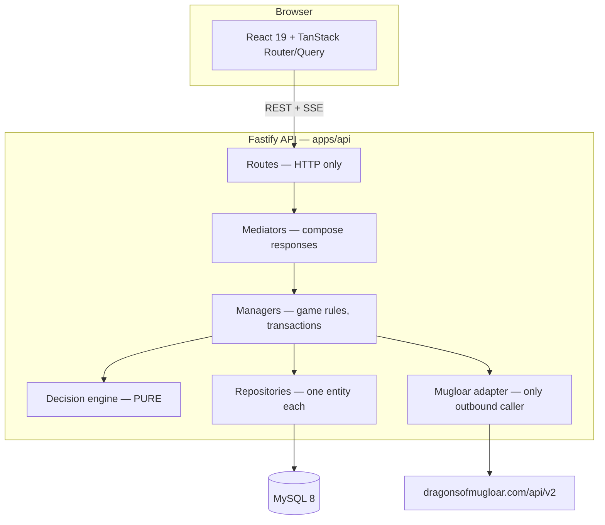

# Architecture

## Overview

One pnpm monorepo, three runtime pieces. Fastify is the **only** thing that talks
to `dragonsofmugloar.com`; the browser never does.



Why everything goes through Fastify: one source of truth for game state; the
decode / retry / `410` logic is written once instead of twice in two languages;
and the advisor can draw on history from every past game, which a browser-only
client could never do.

---

## Layers

```
Routes → Mediators → Managers → Repositories → Adapters
```

Dependencies move **downward only**. Never skip a layer, never call upward.

| Layer            | May call                                       | Must not                                               |
| ---------------- | ---------------------------------------------- | ------------------------------------------------------ |
| **Routes**       | Mediators, Managers                            | contain business logic; touch repositories or adapters |
| **Mediators**    | Managers                                       | contain game rules; touch repositories                 |
| **Managers**     | Repositories, Adapters, Engine, other Managers | be called by anything below them                       |
| **Repositories** | one data-source Adapter                        | span entities; call managers or other repositories     |
| **Adapters**     | one external system                            | contain business logic                                 |
| **Engine**       | nothing                                        | perform I/O of any kind                                |

### Routes

Thin. Extract from the request, call a mediator (or a manager when there's
nothing to compose), bind the response. No logic. Errors bubble to the single
registered Fastify error handler — routes never catch. See
[`routes.md`](routes.md).

### Mediators

API-facing aggregators. They call multiple managers and shape an API response.
They hold no game rules. One file per use case inside an entity folder, named
for the operation — `game-mediator/start-game.ts`, not one growing file.

### Managers

Own one entity's lifecycle, its rules and its transaction boundary. A manager
may compose every repository its transaction writes: `game-manager/` owns the
game state machine and writes a turn's run update together with its attempt or
purchase row, atomically.

### Repositories

Persist one entity. Enforce no business rules. `transform` / `reverseTransform`
convert between the DB row shape (snake_case) and the domain entity (camelCase).

### Adapters

Wrap exactly one external system. `mugloar-api-adapter` is the only code in the
repo that knows the upstream exists, and the only place that knows it is
unreliable — timeouts, bounded retry, HTML-body tolerance and the `410`
translation all live there and nowhere else.

### Engine

**Pure.** No I/O, no clock, no randomness, no imports from outside `domain/`.

---

## Verified API reference

**This section is ground truth and overrides https://dragonsofmugloar.com/doc/.**
Verified against the live API on 2026-11-23.

Base URL: `https://dragonsofmugloar.com/api/v2`. No auth, no API key.

### Endpoints

| Method | Path                               | Returns                                                     |
| ------ | ---------------------------------- | ----------------------------------------------------------- |
| POST   | `/game/start`                      | `{ gameId, lives, gold, level, score, highScore, turn }`    |
| GET    | `/{gameId}/messages`               | **bare array** of ads                                       |
| POST   | `/{gameId}/solve/{adId}`           | `{ success, lives, gold, score, highScore, turn, message }` |
| GET    | `/{gameId}/shop`                   | **bare array** of `{ id, name, cost }`                      |
| POST   | `/{gameId}/shop/buy/{itemId}`      | `{ shoppingSuccess, gold, lives, level, turn }`             |
| POST   | `/{gameId}/investigate/reputation` | `{ people, state, underworld }`                             |

A new game starts at `lives: 3, gold: 0, level: 0, score: 0, turn: 0`.

### Where the published docs lie

| Docs say                                  | Reality                         |
| ----------------------------------------- | ------------------------------- |
| `/messages` returns `{ messages: [...] }` | returns a **bare array**        |
| `/shop` returns `{ items: [...] }`        | returns a **bare array**        |
| `reward` is a String                      | it is a **Number**              |
| `shoppingSuccess` is a String             | it is a **Boolean**             |
| _(not mentioned)_                         | ads carry **`probability`**     |
| _(not mentioned)_                         | ads carry **`encrypted`**       |
| _(not mentioned)_                         | errors are **HTML**, never JSON |
| _(not mentioned)_                         | game over is **HTTP 410**       |

An ad:

```json
{
  "adId": "BR0b2WyN",
  "message": "Help Gisilfrid Jephson to transport a magic wagon to village in Blackcawl",
  "reward": 17,
  "expiresIn": 7,
  "encrypted": null,
  "probability": "Piece of cake"
}
```

### Encryption

`encrypted` is `null`, `1` or `2`, and applies to **`adId`, `message` and
`probability`** — never to `reward` or `expiresIn`.

- `encrypted: 1` → **Base64**. Verified.
- `encrypted: 2` → **ROT13**. Verified 2026-11-23 by `pnpm capture`: probability
  `Vzcbffvoyr` → `Impossible`. Rare — one board in four capture sessions. That ad
  was `Impossible`, so solving with a decoded ROT13 `adId` is still unobserved.

**The `adId` must be decoded before use in the solve URL.** Verified:

```
adId "cVlmaFlnRnQ=" → "qYfhYgFt"
POST /solve/cVlmaFlnRnQ=  → 400 Bad Request
```

Encrypted ads carry disproportionately large rewards (122 and 193 observed
against a typical 1–64), so skipping them is expensive.

### Probability labels

Eleven observed. `"Impossible"` is undocumented and went 0/16 — it is a hard
filter, never an EV calculation.

Prior ranking, best → worst. **A prior only** — the engine measures rather than
trusts it:

```
Sure thing · Piece of cake · Walk in the park · Quite likely · Hmmm....
Gamble · Risky · Rather detrimental · Playing with fire · Suicide mission
Impossible
```

### Shop

Effects verified by buying each item in a fresh game.

| id                                    | name           | cost | effect        |
| ------------------------------------- | -------------- | ---- | ------------- |
| `hpot`                                | Healing potion | 50   | **+1 life**   |
| `cs` `gas` `wax` `tricks` `wingpot`   | —              | 100  | +1 level      |
| `ch` `rf` `iron` `mtrix` `wingpotmax` | —              | 300  | **+2 levels** |

Items of equal cost are interchangeable. The listing is not guaranteed static —
read `/shop` rather than hard-coding ids; keep this table as the fallback prior.

### Errors and lifecycle

| Situation                    | Response                             |
| ---------------------------- | ------------------------------------ |
| Unknown `gameId`             | `404`, **HTML** body                 |
| Unknown or expired `adId`    | `400`, **HTML** body                 |
| Insufficient gold            | `200` + `{"shoppingSuccess": false}` |
| Unknown item id              | `200` + `{"shoppingSuccess": false}` |
| Any call after lives reach 0 | `410` + `{"status": "Game Over"}`    |

Three consequences that cause real bugs if missed:

1. **A failed purchase still advances the turn**, so it costs `expiresIn` on
   every ad on the board. Never speculatively buy.
2. **`410` is a terminal domain state, not an error.** The adapter translates it;
   it never throws.
3. **Never assume a parseable JSON body on a non-2xx response.** This is the
   most likely source of an unhandled crash.

---

## Decision engine

```ts
// pure — no I/O, no clock, no randomness
decide({ state, board, shop, calibration, config }): Decision
```

`Decision` is a discriminated union — `solve`, `buy`, or `stop` — each carrying
a **structured `reasoning` value, not a string**: the estimated success
probability, the expected value, and which rule fired. The bot logs it; the UI
renders it. That is what makes "watch the bot" explicable instead of a spinner.

### Calibration

Every attempt is written to `ad_attempts` with its label, dragon level, turn,
reward and outcome. The estimate is a Laplace-smoothed success rate keyed on
`(label, levelBucket, rewardBand)`:

```
p̂ = (successes + α·prior) / (attempts + α)      α = smoothingAlpha (tuned: 2)
```

With little data the prior dominates; as evidence accumulates, measurement takes
over. Deliberately simple and explainable — a human must be able to justify it on
a whiteboard.

Level **buckets**, not raw levels: the observed degradation is gradual and raw
cells would be too sparse.

**Reward bands** (edges in `StrategyConfig.rewardBandEdges`) because the label
alone lies on lucrative ads. Measured over 20 cold runs: `Sure thing` under 100
gold went 47/47; at 160 and above it went 1/45. Pooling them taught the engine
that a trap was safe. The repository returns raw rewards; the engine buckets
them, so the edges are tunable without a query change.

Calibration is **reloaded before every decision**, not once per game: a run's own
failures, and those of concurrent benchmark games, count from the next turn.

### Selection

1. **Hard filter** — drop `Impossible`; drop anything unreachable before
   `expiresIn`.
2. **Estimate** `p̂` from calibration.
3. **Expected value** — `EV = p̂ · reward − (1 − p̂) · lifeCost`, where
   `lifeCost` is a healing potion (50 gold) plus the turn it burns. This converts
   risk into gold so risky-lucrative and safe-cheap ads compare on one axis.
4. **Survival override**: lives, not gold, are the binding constraint. At or
   below `livesFloor` the engine buys `hpot` before anything else. The tuned
   floor equals the starting lives (3), so every lost life is bought back as soon
   as gold allows. Lives can rise above the start (observed up to 12), but the
   engine never buys above the floor.
   Measured: a run surviving ~90 turns scored 6840; one dying at turn 24 scored 467. **Survival is the strategy.**
5. Take the highest EV clearing `minimumProbability`; else the safest
   attemptable ad; else the board is exhausted (every ad `Impossible` or
   expired, measured from turn ~95), so buy the cheapest affordable level-up;
   else stop. With `levelUpEnabled` (off by default) the engine also levels up
   proactively when no ad clears the floor or gold above `levelUpGoldReserve`
   allows.

All thresholds live in one typed `StrategyConfig`. No magic numbers in the
engine.

### Two strategies

| Strategy     | Uses history     | Purpose                                                           |
| ------------ | ---------------- | ----------------------------------------------------------------- |
| `baseline`   | no — priors only | EV + survival floor. Tests whether the database is needed at all. |
| `calibrated` | yes              | The designed engine.                                              |

Both satisfy the same signature and differ only in the `Calibration` passed in.
The comparison is run in Phase 1 and the result recorded below, whichever way it
falls.

---

## Bot runtime

**Phase 1 ships the loop as CLIs** (`pnpm bot`, `pnpm bench`). They call the
adapter and the calibration loader directly. Before the advisor lands, that
"load calibration, fetch board, decide" path moves behind a manager, so the bot
and the UI share one code path. The registry and `/watch` below are the Phase 2
design and are not built yet.

In Phase 2 the bot runs **in the Fastify process**. A `BotRunRegistry` holds active runs by
`gameId`; `/watch` subscribes and fans out to any number of SSE viewers from one
run. Viewers never drive the loop — a disconnect does not stop a game, and a
reconnect replays from the persisted decision trail.

Concurrent runs are allowed but bounded. The outbound throttle is a **single
process-wide token bucket** shared by bot, benchmark and human traffic, because
what's being protected is the remote host.

A separate worker would need a queue, a second deployable and a cross-process
event path to reach SSE — real cost, no reviewer-visible benefit at this size.
The registry is an interface, so moving the loop out later is contained.

---

## Measured findings

Recorded as they are established. A documented negative result is a finding.

| Question                                 | Status  | Result                                                                                                                |
| ---------------------------------------- | ------- | --------------------------------------------------------------------------------------------------------------------- |
| Does `calibrated` beat `baseline`?       | yes     | 90% vs 55% pass over 20 cold runs each, before any tuning                                                             |
| Do labels mean the same at every reward? | **no**  | `Sure thing` 47/47 under 100 gold, 1/45 at 160+ — hence reward bands in the calibration key                           |
| Does levelling up pay?                   | partly  | proactive: off 100% pass / median 2510, on 95% / 3348, one run apart, so **off**. On an exhausted board: **always**   |
| Does the board run dry?                  | **yes** | by turn ~95 every ad is `Impossible`; with level-ups off, 16/20 acceptance runs stopped there with ~1400 gold unspent |
| Can lives exceed the starting 3?         | yes     | observed up to 12 from repeated potions                                                                               |
| Is `encrypted: 2` ROT13?                 | yes     | captured 2026-11-23; solving needs the decoded id (raw → `400`, decoded → `200`)                                      |
| Do encrypted ads behave differently?     | no      | 0.73 vs 0.72 success; `was_encrypted` column dropped                                                                  |
| Does reputation affect anything?         | skip    | **each call burns a turn**; values move but nothing uses them                                                         |
| Is there upstream rate limiting?         | no      | no `429` across every benchmark at 8 req/s, 3 concurrent games                                                        |

Acceptance (`pnpm bench --runs 20`, cold, tuned defaults): **20/20**, min 1566, median 2687.
Cold means "this benchmark's own games only", so the 20 games share evidence as
they go. 16 of the 20 stopped on an exhausted board. The level-up fallback was
added after this run and changes play only from that point on, so per-game
scores can only rise. It is **not yet re-benchmarked**. Raw numbers, the sweep and the acceptance run:
[`findings/phase-1-benchmark.md`](findings/phase-1-benchmark.md).

Tuned `StrategyConfig` (sweep in the findings file):

```ts
smoothingAlpha: 2,          // a fresh trap cell is unlearned in 3 failures, not 6
levelBucketEdges: [2, 4, 6],
rewardBandEdges: [100, 160],
livesFloor: 3,              // = starting lives: buy back every lost life
minimumProbability: 0.45,   // 0.3 cost 10 points of pass rate
lifeCostInGold: 50,
turnCostInGold: 20,
levelUpEnabled: false,      // proactive only; exhausted boards always level up
levelUpGoldReserve: 350,
```
