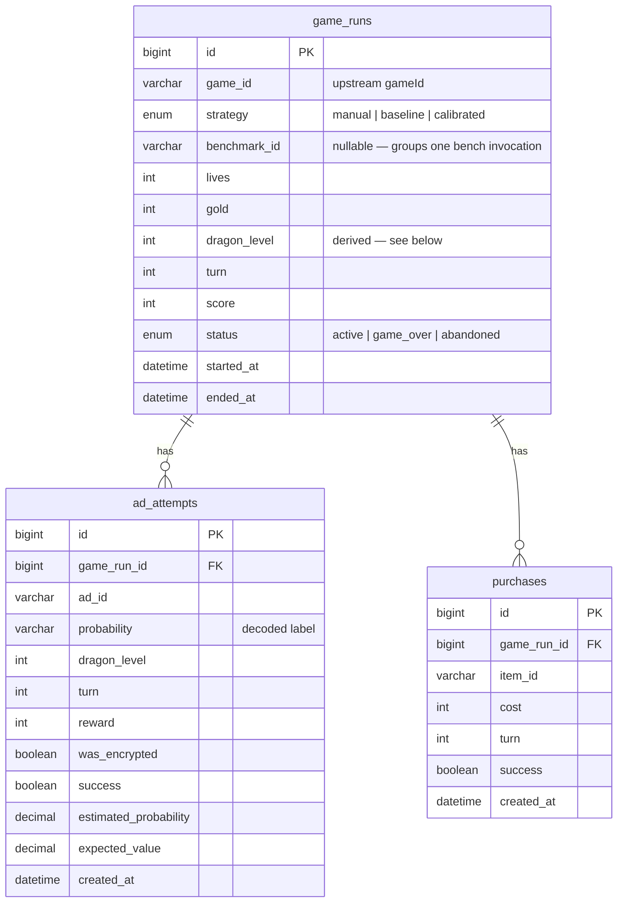

# Database

MySQL 8, accessed through knex. Three tables. No ORM, no cleverness.

## Schema



## Every column has to earn its place

This schema was deliberately trimmed. What was removed and why:

| Removed | Reason |
| --- | --- |
| `final_score`, `final_turn` | Pure duplication. When `status = game_over`, `score` and `turn` **are** the final values. |
| `mode` | Derivable. `strategy = manual` means a human played; a non-null `benchmark_id` means a benchmark run; otherwise it's a bot run. |

`benchmark_id` replaces what `mode` did and earns more than it: `pnpm bench`
needs to group the runs of a single invocation to report a pass rate, and a
boolean could not do that.

**`was_encrypted` on `ad_attempts` is a hypothesis, not a known dimension** — it
tests whether encrypted ads behave differently. One boolean is cheap enough to
keep, but if the Phase 1 data shows no effect, drop it rather than carry an
unused column into the submission.

## Why live state is persisted

`game_runs` carries `lives`, `gold`, `dragon_level`, `turn` and `score` rather
than holding them in process memory, so that an API restart does not orphan
every `active` run and lose a human's game in progress. **Resume is the only
reason** — stated plainly because it is a choice, not a necessity.

There is a separate and sharper point about `dragon_level`:

**`POST /solve` does not return `level`.** Only `/game/start` and `/shop/buy`
do, and there is no "get game state" endpoint upstream. Dragon level is
therefore **derived locally** by accumulating purchases — and it is a calibration
key. If a purchase succeeds but the level update does not, the counter drifts and
every row written for the rest of that run is keyed on a wrong level, silently
poisoning the engine's own estimates.

**Therefore:** `dragon_level` must be updated in the **same transaction** as the
purchase row that changed it. Never update one without the other. This holds
regardless of whether resume is supported.

## Why these tables exist at all

`ad_attempts` is the only table the engine reads. It is the evidence behind every
estimate the advisor shows and every pick the bot makes. Indexed on
`(probability, dragon_level)` — the calibration lookup key.

`estimated_probability` and `expected_value` are stored, not just computed, so
the calibration-quality view can plot **predicted against actual**. That plot is
how the engine's honesty gets demonstrated rather than claimed.

## Writes must never break a game

Gameplay does not depend on persistence succeeding. A database failure is logged
and the engine falls back to the prior ranking; the run continues. A reviewer
whose MySQL container is slow still gets a playable game.

This is the one place where swallowing an error is correct. It is deliberate, and
it is the only such place.

## Patterns

- One repository per entity. A repository never calls another repository or a
  manager.
- `transform` / `reverseTransform` on every repository, converting between the
  row shape (snake_case) and the domain entity (camelCase).
- Transactions are **owned by managers**, never by repositories or routes. A
  manager opens the transaction and passes it down.
- **No `Promise.all` for concurrent writes inside a transaction.**
- Reads used by the engine go through the repository like everything else — the
  engine itself stays pure and receives the `Calibration` as an argument.

## Migrations

```bash
pnpm db:make add_calibration_index   # create
pnpm db:migrate                      # apply
```

- Migrations are forward-only in practice; write `down` anyway.
- Never edit a migration that has run anywhere but your own machine.
- Schema changes land with the code that needs them, in the same branch.
- The integration suite runs migrations from scratch against a throwaway
  container, so a broken migration fails CI rather than a reviewer's laptop.

## Local

```bash
docker compose up -d mysql
pnpm db:migrate
```

Docker runtime is Colima. Container failures usually mean it isn't running —
check `colima status`, restart with `colima restart`.
