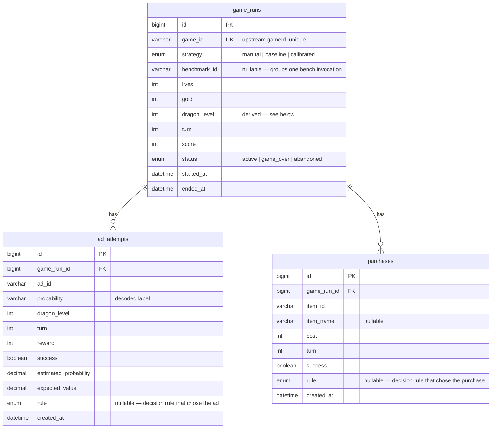

# Database

MySQL 8, accessed through knex. Three tables. No ORM, no cleverness.

## Schema



Three migrations in `apps/api/migrations/` build this schema:

1. `20261124000001_create_core_tables.ts` creates the three tables.
2. `20261124000002_add_move_rule.ts` adds the three nullable columns the move log
   reads (`ad_attempts.rule`, `purchases.rule`, `purchases.item_name`). See _The
   move log columns_ below.
3. `20261125000001_unique_game_id.ts` replaces the plain index on
   `game_runs.game_id` with a unique one. One upstream game is one run: the plain
   index let a duplicate in silently, and a read had to guess which row was
   current. `gameRunRepository.db.findOne` is now a plain
   `where({ game_id }).first()`, with no ordering.

## Every column has to earn its place

This schema was deliberately trimmed. What was removed and why:

| Removed                     | Reason                                                                                                                          |
| --------------------------- | ------------------------------------------------------------------------------------------------------------------------------- |
| `final_score`, `final_turn` | Pure duplication. When `status = game_over`, `score` and `turn` **are** the final values.                                       |
| `mode`                      | Derivable. `strategy = manual` means a human played; a non-null `benchmark_id` means a benchmark run; otherwise it's a bot run. |

`benchmark_id` replaces what `mode` did and earns more than it: `pnpm bench`
needs to group the runs of a single invocation to report a pass rate, and a
boolean could not do that.

**`was_encrypted` was a hypothesis, and Phase 1 disproved it.** It tested
whether encrypted ads behave differently. Over two cold benchmarks they did not
(0.73 success encrypted, n = 40, against 0.72 plaintext, n = 781), so the
schema does not create it rather than carry an unused column into the
submission. The `Ad` contract still says whether an ad was encrypted; only the
stored dimension went.

**`reward` is a calibration key**, bucketed into bands by the engine — see
[`architecture.md`](architecture.md) _Calibration_ for the measurement behind
it.

## The move log columns

`GET /api/games/:gameId/moves` shows the reason for every move, and the engine's
`Reasoning.rule` was not stored, nor was the shop item's name (only `item_id`,
such as `hpot`). The second migration adds them, additively:

| Column                | Type                       | Written by                                                  |
| --------------------- | -------------------------- | ----------------------------------------------------------- |
| `ad_attempts.rule`    | enum of the decision rules | the solve path, from the decision's `reasoning.rule`        |
| `purchases.rule`      | enum of the decision rules | the buy path, from the decision's `reasoning.rule`          |
| `purchases.item_name` | `varchar(64)`              | the buy path, from the `ShopItem` the move was made against |

The enum values are `survival_floor`, `level_up`, `best_expected_value`,
`safest_available`, `no_viable_option` and `player_choice`. A move a human makes
through `/play` records `player_choice`. The engine no longer chooses
`level_up`; the value stays in the enum and the contract only so that rows
stored by the level-up experiments still read.

All three are **nullable**, because rows written before the migration have no
recorded rule and must stay valid. The API and the web app treat `null` as "no
reason to show", not as an error. The migration lists the enum values as
literals rather than importing the contracts' constant: it is a frozen record of
the schema at one point in time and must not change when the code does.

`rule` is not a calibration key, so the engine never reads it. These columns
exist for the move log only.

## Why live state is persisted

`game_runs` carries `lives`, `gold`, `dragon_level`, `turn` and `score` rather
than holding them in process memory, so that an API restart does not orphan
every `active` run and lose a human's game in progress. **Resume is the only
reason** — stated plainly because it is a choice, not a necessity.

There is a separate and sharper point about `dragon_level`:

**`POST /solve` does not return `level`.** Only `/game/start` and `/shop/buy`
do, and there is no "get game state" endpoint upstream. Dragon level is
therefore **derived locally** by accumulating purchases — and it is a calibration
key. If a purchase succeeds but the level update does not, the counter drifts and
every row written for the rest of that run is keyed on a wrong level, silently
poisoning the engine's own estimates.

**Therefore:** `dragon_level` must be updated in the **same transaction** as the
purchase row that changed it. Never update one without the other. This holds
regardless of whether resume is supported.

## Why these tables exist at all

`ad_attempts` is the only table the engine reads. It is the evidence behind every
estimate the advisor shows and every pick the bot makes. The advisor reads the
counts on every `/turn`; a bot reads them at its start and every 10 turns, and
adds its own saved attempts in memory in between. Indexed on
`(probability, dragon_level)`, the leading columns of the calibration lookup key
`(probability, dragon_level, reward)`.

`estimated_probability` and `expected_value` are stored, not just computed, so
the engine's estimate can be compared with the outcome afterwards, and so the
move log can show the numbers the engine acted on. A calibration-quality view
that plots **predicted against actual** is not built; the data for it is there.

## Writes must never break a game

Gameplay does not depend on persistence succeeding where the upstream turn has
already happened. Every place that catches an error and carries on, and nowhere
else:

| Where                                                              | Swallows                                                                   | Then                                                                                          |
| ------------------------------------------------------------------ | -------------------------------------------------------------------------- | --------------------------------------------------------------------------------------------- |
| `calibration-manager` `loadCalibration`                            | a failed counts read                                                       | logs `warn`; uses the prior at a game's start, the calibration held so far on a bot's re-read |
| `game-manager` `saveStateWithRecord`, `'keep_playing'` (bot)       | a failed transaction for a turn's state and row                            | logs `warn`, plays on with the state in memory; the attempt is not learned                    |
| `game-manager` `saveStateWithRecord`, `'save_state_only'` (player) | a failed transaction for a turn's state and row                            | logs `warn`, writes the state alone; if that fails too, throws `PersistenceFailedError` (500) |
| `game-manager` `recordGameOver`                                    | a failed `finishRun` on game over                                          | logs `warn`; game over is still reported                                                      |
| `bot-manager` `playGame`, per turn                                 | `UpstreamUnavailableError`, `AdExpiredError`                               | logs `warn`, plays the next turn; the third in a row rethrows                                 |
| `bot-manager` `playGame`, on finish                                | a failed final `finishRun`                                                 | logs `warn`; the row stays `active`                                                           |
| `bot-mediator` `startBotGame`                                      | the detached game's rejection                                              | logs `error`; the run was already ended `abandoned` where the write allowed                   |
| `health-manager` `checkDatabase`                                   | a failed `select 1`                                                        | logs `warn`, answers `503 { status: 'unavailable' }`                                          |
| `cli/bounded-pool.ts` `runBounded`                                 | one benchmark run's error                                                  | counts it in `failedRuns`; the other runs go on                                               |
| `wire-schemas.ts` `AdListWireSchema`, `domain/decode-ad.ts`        | one ad that does not parse, decodes to an unknown label or to an unsafe id | drops that ad, keeps the board                                                                |

**The player fallback.** A human's next move rebuilds its state from the
`game_runs` row, so a lost write would carry a stale dragon level forward for
good. When a solve or buy's transaction fails after the upstream move, the
attempt or purchase row is given up, but the state (`lives`, `gold`,
`dragon_level`, `turn`, `score`) is written on its own; if that fails as well,
the request answers `500` rather than letting the row drift. The bot keeps its
state in memory, so it needs no such fallback. Either way the result says
whether the record landed (`persisted`), and a bot folds an attempt into its
in-memory calibration only when it did, so memory never holds evidence the
table lacks.

## Patterns

- One repository per entity. A repository never calls another repository or a
  manager.
- `transform` / `reverseTransform` on every repository, converting between the
  row shape (snake_case) and the domain entity (camelCase).
- Transactions are **owned by managers**, never by repositories or routes. A
  manager opens the transaction and passes it down.
- **No `Promise.all` for concurrent writes inside a transaction.**
- Reads used by the engine go through the repository like everything else — the
  engine itself stays pure and receives the `Calibration` as an argument.

## Migrations

```bash
pnpm db:make add_calibration_index   # create
pnpm db:migrate                      # apply
```

- Migrations are forward-only in practice; write `down` anyway.
- Never edit a migration that has run anywhere but your own machine.
- Schema changes land with the code that needs them, in the same branch.
- `pnpm test:integration` rolls back every migration and re-applies them on
  `dragon_test`, so a broken migration fails that command rather than a
  reviewer's first `docker compose up`.
- `pnpm db:migrate` runs `apps/api/src/migrate.ts` (knex `migrate.latest()`).
  The Docker image runs the same file with plain `node` before the server
  starts.

## Local

```bash
docker compose up -d --wait mysql   # returns once the healthcheck passes
pnpm db:migrate
```

The container also creates `dragon_test` on first start
(`docker/mysql/01-test-database.sql`). `pnpm test:integration` migrates that
database from scratch and never touches `dragon`. An init script only runs on an
empty volume — after changing it, `docker compose down -v`.

Docker runtime is Colima. Container failures usually mean it isn't running —
check `colima status`, restart with `colima restart`.
